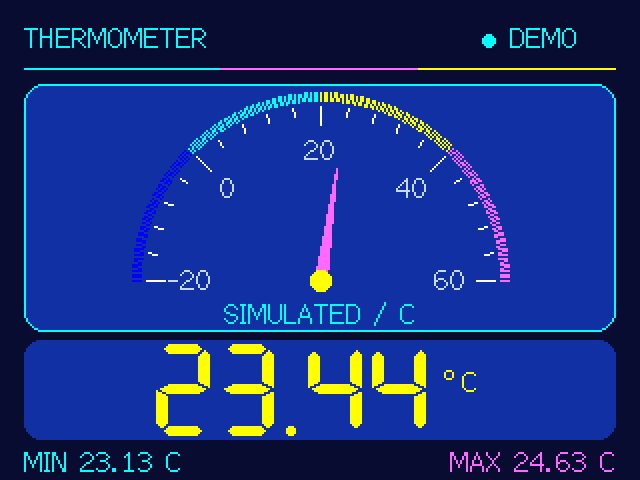

# G1ROK CYD Thermometer

A small, colourful thermometer built around an ESP32 Cheap Yellow Display (CYD) and a DS18B20 temperature sensor. A semicircular dial gives an at-a-glance reading; a large digital display and session minimum/maximum show the detail.

**Version 1.1.0 — choose ILI9341 or ST7789 firmware for your board.**

**[Download the latest release](https://github.com/Courty40/CYD-Thermometer/releases/latest)** · **[G1ROK — Radio. Electronics. Making.](https://g1rok.co.uk)**



*Software layout preview, not a photograph of the physical display.*

## What it does

- Displays temperature in Celsius, refreshed approximately once a second.
- Shows an analogue dial, a two-decimal digital reading and session minimum/maximum.
- Uses 12-bit DS18B20 conversions; missing sensors and failed reads show a clear message instead of a stale temperature.
- Reconnects automatically when a supported sensor becomes available.
- Offers a separately labelled demo build for trying the display without a sensor.
- Runs locally, without touch controls or a network connection.

## Hardware

- An ESP32-WROOM-based **ESP32-2432S028-style CYD**, with a 240 × 320 ILI9341-compatible display (used landscape at 320 × 240), 4 MB flash and the pin mapping below.
- One externally powered, three-wire **DS18B20** sensor.
- A **4.7 kΩ** pull-up resistor, unless already fitted to the sensor module.
- A data-capable USB cable and a suitable USB power source.

CYD is a family of boards. Check the display controller and connections before flashing: Choose the matching build from the table below. Other controller types and different GPIO layouts are not supported by these configurations. Touch hardware is not used. This repository retains the original board-specific display setup; this release has been built and checked automatically, but has not been physically retested on every CYD variant.

### Choose your display profile

| Board configuration | Sensor environment | Demo environment | Colour configuration |
| --- | --- | --- | --- |
| ILI9341 CYD (default) | `cyd` | `demo` | ILI9341_2 driver; inversion on |
| Common CYD2USB ST7789 | `cyd_st7789` | `demo_st7789` | ST7789 driver; BGR; inversion off |

The ST7789 profile follows the [CYD2USB board reference](https://github.com/witnessmenow/ESP32-Cheap-Yellow-Display/blob/main/DisplayConfig/CYD2USB/User_Setup.h), using a conservative 40 MHz SPI clock. Both profiles use the GPIO table below. The ST build is compiled and logic-checked but **awaits a physical display check**; it is not a universal ST7789 firmware. USB-port count is a clue, not proof of the controller or pinout. Serial startup identifies the selected display profile and firmware version.

### Sensor wiring

Disconnect power before wiring. Use the labels on your board rather than assuming the connector pin order or sensor wire colours.

| DS18B20 connection | CYD connection |
| --- | --- |
| VDD | 3.3 V |
| GND | GND |
| DQ (data) | GPIO27 |
| Pull-up resistor | 4.7 kΩ between DQ and 3.3 V |

This project uses external three-wire power. Parasite-powered sensors are not supported. If several sensors are attached, the first eligible DS18B20 found is used; this is a single-temperature display.

### Display connections

| Signal | GPIO |
| --- | --- |
| MISO | 12 |
| MOSI | 13 |
| SCLK | 14 |
| CS | 15 |
| DC | 2 |
| Backlight | 21 (active high) |
| Reset | Not connected (`-1`) |

Both displays use HSPI at 40 MHz and rotation 1. The ILI9341 profile uses `ILI9341_2_DRIVER` and colour inversion enabled; ST7789 uses `ST7789_DRIVER`, BGR colour order and inversion disabled. These settings are in `platformio.ini`; `DISPLAY_INVERT` can be overridden with a build flag if a different panel requires it.

## Install a release

The simplest source-based route is PlatformIO, below. Prebuilt binaries are also provided on the [Releases page](https://github.com/Courty40/CYD-Thermometer/releases).

Choose the controller in the filename:

- **`CYD-Thermometer-v1.1.0-ili9341-full.bin`** — complete ILI9341 sensor firmware, flash at **`0x0`**.
- **`CYD-Thermometer-v1.1.0-st7789-full.bin`** — complete ST7789 sensor firmware, flash at **`0x0`**.
- **`…-ili9341-app.bin` / `…-st7789-app.bin`** — application-only files for **`0x10000`**, requiring the matching existing bootloader and partition table.
- **`…-ili9341-demo-full.bin` / `…-st7789-demo-full.bin`** — complete display demonstrations for **`0x0`**. They do not measure temperature.
- **`SHA256SUMS.txt`** — checksums for the six files in this release.

A [browser USB installer](https://g1rok.co.uk/Projects/cyd-thermometer/install) is also available on G1ROK. Select the correct display/controller and version before connecting.

Flashing replaces the firmware already on the board. These images are for the original ESP32 with 4 MB flash, not ESP32-S3/C3 boards.

With Python and esptool 4.9.0 installed, connect the board by USB and substitute its actual serial port:

```sh
python -m pip install esptool==4.9.0
python -m esptool --chip esp32 --port COM5 --baud 115200 write_flash 0x0 CYD-Thermometer-v1.1.0-ili9341-full.bin
```

On Linux the port may be `/dev/ttyUSB0`. Do not use an application-only image at address zero. A full image replaces the bootloader, partition table and application, but does not promise to erase unrelated flash beyond the image.

## Build and upload with PlatformIO

1. Install [VS Code](https://code.visualstudio.com/) and the [PlatformIO IDE extension](https://platformio.org/install/ide?install=vscode).
2. Clone this repository or download and extract its source ZIP.
3. Open the folder containing `platformio.ini`.
4. Connect the CYD using a data-capable USB cable.
5. Build, then Upload. The default **`cyd`** environment reads the real sensor.

Equivalent commands in a PlatformIO terminal:

```sh
pio run -e cyd
pio run -e cyd -t upload
pio device monitor -b 115200
```

For ST7789, use `pio run -e cyd_st7789 -t upload`. For an ST7789 simulation, use `pio run -e demo_st7789 -t upload`.

For a simulated ILI9341 display, use `pio run -e demo -t upload`. Restore the real sensor firmware with `pio run -e cyd -t upload` afterwards. The demo always displays a **DEMO** badge and **SIMULATED** caption.

Pinned dependencies: Espressif32 platform 6.12.0 (Arduino), TFT_eSPI 2.5.43, OneWire 2.3.8 and DallasTemperature 4.0.6. PlatformIO installs these automatically.

## Reading the display

The normal dial spans −20 to +60 °C. A reading outside that range changes it to −60 to +140 °C until restart, so the complete sensor range fits. The coloured bands are decorative, not alarm thresholds.

The DS18B20 measures −55 to +125 °C. Its 12-bit step is **0.0625 °C**; two decimal places are a display format, not a claim of hundredth-degree accuracy. The manufacturer specifies ±0.5 °C accuracy from −10 to +85 °C. See the [Analog Devices DS18B20 information](https://www.analog.com/en/products/DS18B20.html).

Minimum and maximum are kept in RAM for the current powered session. Disconnecting a sensor hides the live value but retains its history; connecting a different sensor resets that history. Restarting resets all readings.

## Troubleshooting

| Symptom | Check |
| --- | --- |
| Sensor not connected | 3.3 V, ground, GPIO27, the pull-up resistor and the sensor pinout. The scan retries every three seconds. |
| Sensor read failed | Loose connections, cable length, power and interference. Invalid reads clear the displayed value and trigger a retry. |
| Use 3-wire sensor power | The sensor appears to be parasite powered; connect VDD to 3.3 V. |
| DEMO or SIMULATED on screen | The demonstration firmware is installed. Upload the `cyd` build. |
| Blank screen or wrong colours | Confirm the controller and display GPIOs. Other CYD revisions may need different settings. |
| USB upload cannot connect | Check the selected port, data cable and USB-serial driver. Close other serial monitors; try holding BOOT while the upload connects. |

## Development and checks

See [BUILD_CHECK.md](BUILD_CHECK.md) for the release validation and [CHANGELOG.md](CHANGELOG.md) for changes. Host tests exercise the real application logic with fake sensor/display interfaces. Run them using a C++11 compiler:

```sh
c++ -std=c++11 -Itests/fakes -Iinclude tests/test_firmware.cpp -o thermometer-tests
./thermometer-tests
c++ -std=c++11 -DTHERMOMETER_DEMO=1 -Itests/fakes -Iinclude tests/test_firmware.cpp -o thermometer-demo-tests
./thermometer-demo-tests
```

Repeat the host commands with `-DST7789_DRIVER=1` to test the ST profile. Run `python scripts/check_profiles.py` to check the resolved PlatformIO driver/wiring settings.

To package release files after building all four environments, use the PlatformIO Python environment to run `python scripts/package_release.py`. Generated files go in `dist/` and are not committed.

## Credits

Created by Paul, **G1ROK**. Built with [TFT_eSPI](https://github.com/Bodmer/TFT_eSPI), [OneWire](https://github.com/PaulStoffregen/OneWire) and [DallasTemperature](https://github.com/milesburton/Arduino-Temperature-Control-Library). Board pin reference: [ESP32 Cheap Yellow Display](https://github.com/witnessmenow/ESP32-Cheap-Yellow-Display/blob/main/PINS.md). Third-party components retain their own licences.

## Licensing

The original project source and documentation are available under the [MIT licence](LICENSE), including versions 1.0.0 and 1.1.0. Copyright © 2026 Paul (G1ROK). Third-party libraries retain their own licences.
